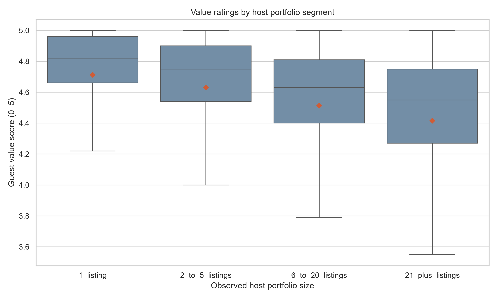
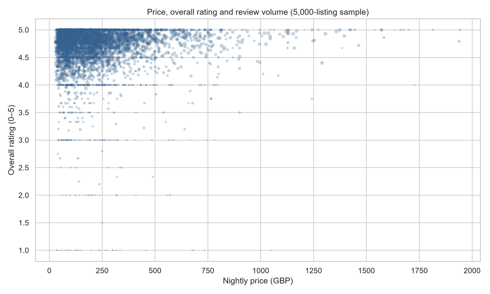
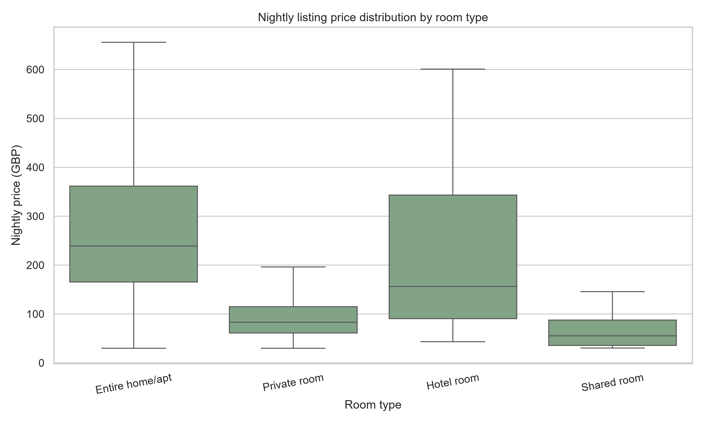
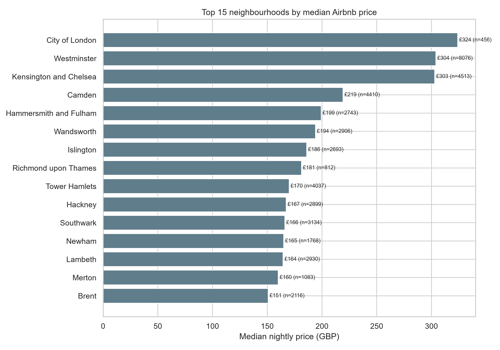
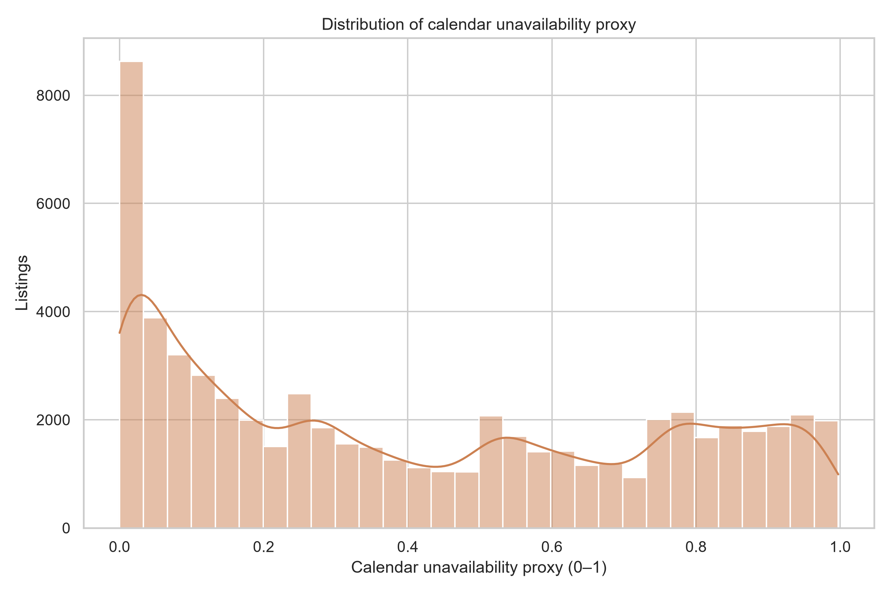
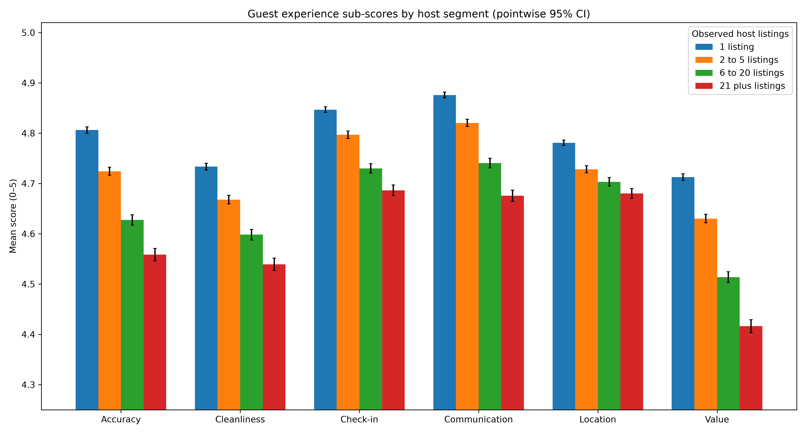
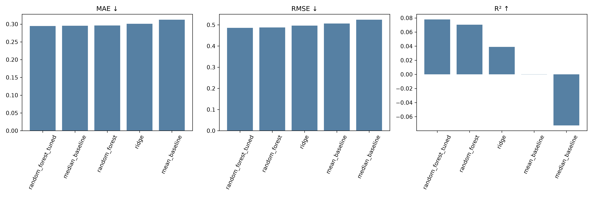
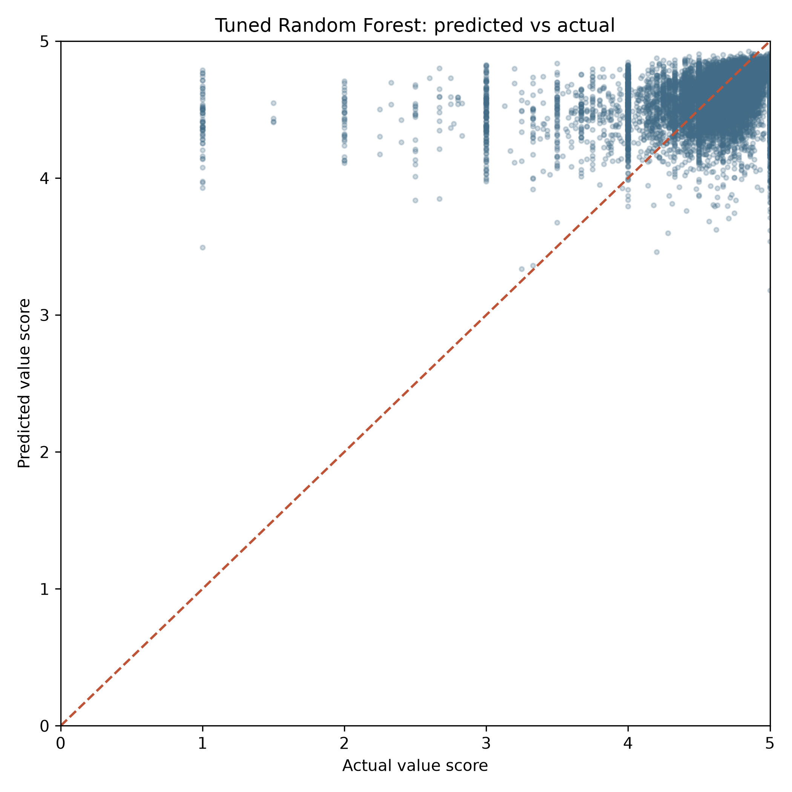
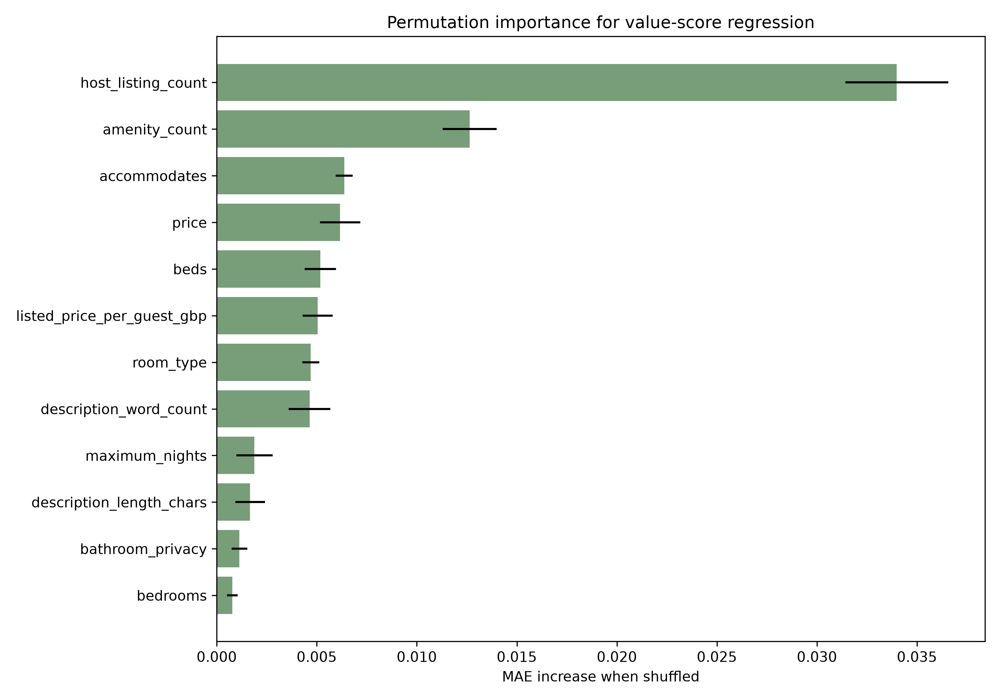
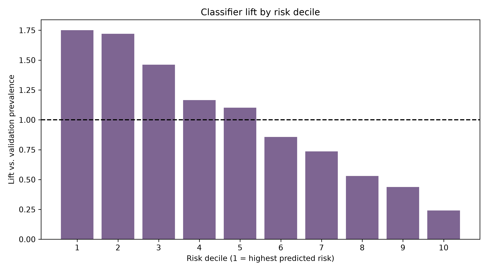

# Report Data Pack — Decoding the Stay Economy

**Dashboard status:** Design only, not built; no PBIX or Streamlit app was found.
**Final snapshot:** Detailed Inside Airbnb London snapshot, 92,638 raw listings and 61,617 clean listings.
**Report format:** 35–50 pages; APA.
**Team names, PRNs, roll numbers, guide:** NOT AVAILABLE.
**Rubric:** None supplied.

> Data pack, not the final report. Raw CSV counts were made with chunked reads; large files were not loaded fully. Existing processed files were used and the 33,871,636-row calendar was not rerun. New files are limited to this document and report_assets/.

## Raw inventory

| Raw file | Rows | Columns | Header |
| --- | --- | --- | --- |
| ../listings.csv/listings.csv | 92,638 | 90 | id, listing_url, scrape_id, last_scraped, source, name, description, neighborhood_overview, picture_url, host_id, host_url, host_profile_id, host_profile_url, host_name, host_since, hosts_time_as_user_years, hosts_time_as_user_months, hosts_time_as_host_years, hosts_time_as_host_months, host_location, host_about, host_response_time, host_response_rate, host_acceptance_rate, host_is_superhost, host_thumbnail_url, host_picture_url, host_neighbourhood, host_listings_count, host_total_listings_count, host_verifications, host_has_profile_pic, host_identity_verified, neighbourhood, neighbourhood_cleansed, neighbourhood_group_cleansed, latitude, longitude, property_type, room_type, accommodates, bathrooms, bathrooms_text, bedrooms, beds, amenities, price, price_quote_checkin_date, price_quote_checkout_date, price_quote_total_price, price_quote_price_per_night, price_quote_raw, minimum_nights, maximum_nights, minimum_minimum_nights, maximum_minimum_nights, minimum_maximum_nights, maximum_maximum_nights, minimum_nights_avg_ntm, maximum_nights_avg_ntm, calendar_updated, has_availability, availability_30, availability_60, availability_90, availability_365, calendar_last_scraped, number_of_reviews, number_of_reviews_ltm, number_of_reviews_l30d, availability_eoy, number_of_reviews_ly, estimated_occupancy_l365d, estimated_revenue_l365d, first_review, last_review, review_scores_rating, review_scores_accuracy, review_scores_cleanliness, review_scores_checkin, review_scores_communication, review_scores_location, review_scores_value, license, instant_bookable, calculated_host_listings_count, calculated_host_listings_count_entire_homes, calculated_host_listings_count_private_rooms, calculated_host_listings_count_shared_rooms, reviews_per_month |
| ../calendar.csv/calendar.csv | 33,871,636 | 5 | listing_id, date, available, minimum_nights, maximum_nights |
| ../reviews.csv/reviews.csv | 2,241,353 | 6 | listing_id, id, date, reviewer_id, reviewer_name, comments |
| ../archive/Hotel_Reviews.csv | 515,738 | 17 | Hotel_Address, Additional_Number_of_Scoring, Review_Date, Average_Score, Hotel_Name, Reviewer_Nationality, Negative_Review, Review_Total_Negative_Word_Counts, Total_Number_of_Reviews, Positive_Review, Review_Total_Positive_Word_Counts, Total_Number_of_Reviews_Reviewer_Has_Given, Reviewer_Score, Tags, days_since_review, lat, lng |

Source: each raw file linked by relative path in the table; headers read with pandas nrows=0 and records counted in chunks.

## Current processed output inventory

| Processed file | Rows | Columns |
| --- | --- | --- |
| data/processed/airbnb_listings_clean.csv | 61,617 | 38 |
| data/processed/airbnb_calendar_clean.csv | 33,871,636 | 7 |
| data/processed/airbnb_reviews_clean.csv | 2,241,112 | 8 |
| data/processed/booking_london_clean.csv | 262,298 | 22 |
| data/processed/airbnb_master.csv | 61,617 | 47 |
| data/processed/airbnb_features.csv | 61,617 | 74 |
| data/processed/airbnb_calendar_agg.csv | 92,799 | 5 |
| data/processed/airbnb_reviews_agg.csv | 70,831 | 5 |
| data/processed/comparison_schema.csv | 323,915 | 15 |

Source: data/processed CSVs; headers and row counts checked from stored files. Root output/ does not exist. Nested statistics/modeling CSVs and model artifacts are listed in the verification ledger.

## Front matter inputs

- **Title:** Decoding the Stay Economy: Airbnb London, with Booking.com as secondary context. [README.md; reports/Project_Status_Report.docx]
- **Course:** IT3233C Data Science & Analytics (course code supplied by user; verify against official syllabus).
- **Team details and supervisor:** NOT AVAILABLE; must be supplied for final title page.
- **Abstract data inputs:** 61,617 clean Airbnb listings; 48,322 with overall ratings; 48,319 with value scores; 262,298 London Booking.com review rows. [data/processed/airbnb_features.csv; data/processed/booking_london_clean.csv; counts recomputed]
- **Methods:** rank-based group comparisons with Holm correction/effect sizes; host-grouped regression/classification. [scripts/statistical_analysis.ipynb; scripts/value_rating_model.ipynb; scripts/value_rating_low_value_classifier.ipynb]

## 1. Problem Formulation

**Business problem:** Hosts and marketplace operators need a practical way to identify listing profiles that may warrant a closer look at guest expectations and value messaging.

**Research question:** Can listing and host characteristics help prioritize listings more likely to fall at or below the training-set lower quartile of guest-perceived value ratings, so operators can investigate voluntarily?

**Aim:** Analyze London Airbnb rating patterns and evaluate a host-held-out value-score model as an exploratory triage aid. The model predicts a lower-tail value-score label, not overall rating, objective quality, causes, optimal price, or legal compliance. [reports/complete_project_summary.md; reports/value_rating_model.md; model notebooks]

**Objectives:** collect and clean sources; explore price/listing/rating patterns; engineer interpretable features; test group differences; evaluate regressors and a low-value classifier; give cautious operational recommendations; assess ethics and privacy.

**Scope:** London Airbnb listing-level snapshot; only rated listings enter supervised models. Booking.com is secondary, older review-grain context. No direct platform quality verdict, financial simulation, causal analysis, or automatic host action.

**Stakeholders:** hosts, marketplace operators/analysts, guests, local authorities, and course assessors.

**Success criteria:** no numeric model-performance or business-uplift threshold was defined (NOT AVAILABLE). Coursework lifecycle stages are documented; trained models and analyses exist; Power BI dashboard is design only, not built; no financial simulation is present. [reports/*.md; repository inventory]

Table 1.1: Deliverable status

| Deliverable | Status |
| --- | --- |
| Problem, data, cleaning, EDA, features, statistics | Documented / outputs present |
| Machine learning | Trained artifacts and metrics present |
| Power BI dashboard | DESIGN ONLY, NOT BUILT |
| Financial impact estimate | NOT AVAILABLE / not simulated |
| Numeric success threshold | NOT AVAILABLE / none specified |

Source: project reports and local file inventory.

## 2. Data Collection

Table 2.1: Sources, periods, grains, sizes, and terms

| Source | URL | File | Grain | Period | Size | Terms |
| --- | --- | --- | --- | --- | --- | --- |
| Inside Airbnb London listings | https://insideairbnb.com/get-the-data/ | ../listings.csv/listings.csv | listing | scrape dates 2026-06-19 to 2026-07-01 | 92,638 rows × 90 columns | Inside Airbnb policy: minimize, do not republish, attribute/cite; specific reuse license NOT AVAILABLE. |
| Inside Airbnb London calendar | https://insideairbnb.com/get-the-data/ | ../calendar.csv/calendar.csv | listing-date | calendar dates in source; no price field | 33,871,636 × 5 | Same Inside Airbnb policy; do not redistribute raw data. |
| Inside Airbnb London reviews | https://insideairbnb.com/get-the-data/ | ../reviews.csv/reviews.csv | review | date field; not yet included in period summary | 2,241,353 × 6 | Same policy; review text may include personal details. |
| Kaggle 515K Hotel Reviews Data in Europe, uploader jiashenliu | https://www.kaggle.com/datasets/jiashenliu/515k-hotel-reviews-data-in-europe | ../archive/Hotel_Reviews.csv | review | London rows 2015-08-04 to 2017-08-03 | 515,738 × 17 source; 262,298 × 22 London cleaned | Kaggle dataset license NOT AVAILABLE in local metadata; verify before redistribution. |

Source: raw files, processed files, project README/status report; URL terms checked against Inside Airbnb Data Policies and GOV.UK as of 2026-11-01.

**Collection limitations:** Airbnb is listing-grain while Booking.com is review-grain; time periods differ; Booking has no equivalent price or capacity. Raw calendar has no price, so daily-price volatility cannot be computed.

### Listing schema

Table 2.2: Airbnb cleaned listing schema (type, unit, meaning, missingness)

| Field | Type | Unit | Description | Missing |
| --- | --- | --- | --- | --- |
| id | int64 | identifier | Listing identifier | 0.00% |
| host_id | int64 | identifier | Host identifier | 0.00% |
| host_is_superhost | object | category / source field | Superhost status flag | 0.11% |
| host_response_time | float64 | category / source field | Host response-time category | 100.00% |
| host_response_rate | float64 | category / source field | Host response rate (%) | 100.00% |
| host_acceptance_rate | float64 | category / source field | Host acceptance rate (%) | 100.00% |
| neighbourhood_cleansed | object | category / source field | Cleansed neighbourhood | 0.00% |
| latitude | float64 | degrees | Listing latitude | 0.00% |
| longitude | float64 | degrees | Listing longitude | 0.00% |
| property_type | object | category / source field | Property category | 0.00% |
| room_type | object | category / source field | Room category | 0.00% |
| accommodates | int64 | guests | Stated guest capacity | 0.00% |
| bathrooms | float64 | bathrooms | Bathroom count | 10.43% |
| bedrooms | float64 | bedrooms | Bedroom count | 22.02% |
| beds | float64 | beds | Bed count | 6.68% |
| price | float64 | GBP/night | Nightly price | 0.00% |
| minimum_nights | float64 | nights | Minimum booking nights | 0.00% |
| maximum_nights | float64 | nights | Maximum booking nights | 0.00% |
| availability_30 | int64 | days | Available days in next 30 | 0.00% |
| availability_60 | int64 | days | Available days in next 60 | 0.00% |
| availability_90 | int64 | days | Available days in next 90 | 0.00% |
| availability_365 | int64 | days | Available days in next 365 | 0.00% |
| number_of_reviews | int64 | category / source field | Recorded review count | 0.00% |
| number_of_reviews_ltm | int64 | category / source field | Reviews in trailing year | 0.00% |
| first_review | object | date | First review date | 21.58% |
| last_review | object | date | Last review date | 21.58% |
| review_scores_rating | float64 | score / 5 | Overall rating | 21.58% |
| review_scores_accuracy | float64 | score / 5 | Accuracy sub-score | 21.58% |
| review_scores_cleanliness | float64 | score / 5 | Cleanliness sub-score | 21.58% |
| review_scores_checkin | float64 | score / 5 | Check-in sub-score | 21.58% |
| review_scores_communication | float64 | score / 5 | Communication sub-score | 21.58% |
| review_scores_location | float64 | score / 5 | Location sub-score | 21.58% |
| review_scores_value | float64 | score / 5 | Value-for-money sub-score | 21.58% |
| instant_bookable | float64 | category / source field | Instant booking flag | 100.00% |
| reviews_per_month | float64 | category / source field | Average reviews per month | 21.58% |
| estimated_occupancy_l365d | int64 | category / source field | Source estimated occupancy field | 0.00% |
| estimated_revenue_l365d | float64 | category / source field | Source estimated revenue field | 0.00% |
| has_reviews | bool | category / source field | Derived: number_of_reviews > 0 | 0.00% |

Source: data/processed/airbnb_listings_clean.csv; missingness computed from the file.

### Booking.com schema

Table 2.3: Booking.com cleaned schema

| Field | Type | Unit | Description | Missing |
| --- | --- | --- | --- | --- |
| Hotel_Address | object | category / source field | Hotel address | 0.00% |
| Additional_Number_of_Scoring | int64 | category / source field | Ratings without written review count | 0.00% |
| Review_Date | object | date | Review date | 0.00% |
| Average_Score | float64 | score / 10 | Hotel displayed average score | 0.00% |
| Hotel_Name | object | category / source field | Hotel name | 0.00% |
| Reviewer_Nationality | object | category / source field | Reviewer nationality field | 0.00% |
| Negative_Review | object | category / source field | Negative review text | 0.32% |
| Review_Total_Negative_Word_Counts | int64 | category / source field | Negative review word count | 0.00% |
| Total_Number_of_Reviews | int64 | category / source field | Source hotel review count | 0.00% |
| Positive_Review | object | category / source field | Positive review text | 0.04% |
| Review_Total_Positive_Word_Counts | int64 | category / source field | Positive review word count | 0.00% |
| Total_Number_of_Reviews_Reviewer_Has_Given | int64 | category / source field | Source reviewer review count | 0.00% |
| Reviewer_Score | float64 | score / 10 | Individual reviewer score | 0.00% |
| Tags | object | category / source field | Trip/guest tag text | 0.00% |
| days_since_review | object | category / source field | Source review recency string | 0.00% |
| lat | float64 | degrees | Hotel latitude | 0.00% |
| lng | float64 | degrees | Hotel longitude | 0.00% |
| trip_type | object | category / source field | Trip type parsed from Tags | 3.47% |
| guest_type | object | category / source field | Guest type parsed from Tags | 0.00% |
| sentiment_word_diff | int64 | category / source field | Positive minus negative word-count proxy | 0.00% |
| has_positive_text | bool | category / source field | Positive review text present flag | 0.00% |
| has_negative_text | bool | category / source field | Negative review text present flag | 0.00% |

Source: data/processed/booking_london_clean.csv; missingness computed from the file.

## 3. Cleaning and Preprocessing

| Step | Rows in | Rows out | Action |
|---|---:|---:|---|
| Airbnb listings raw | 92,638 | 92,638 | 90 source columns |
| Select listing fields | 92,638 | 92,638 | 37 source fields selected |
| Drop missing price | 92,638 | 62,240 | 30,398 missing-price rows removed |
| Percentile trim | 62,240 | 61,617 | Drop 623 beyond inclusive 0.5th–99.5th percentile |
| Deduplicate listing ID | 61,617 | 61,617 | 0 duplicates |
| Airbnb review comments | 2,241,353 | 2,241,112 | Drop 241 without comments or listing_id |
| Booking London address filter | 515,738 | 262,301 | Address includes London |
| Booking exact duplicate removal | 262,301 | 262,298 | Drop 3 exact duplicate rows |

Table 3.1: Cleaning lifecycle. Source: data/processed/cleaning_report.txt; counts independently matched to stored outputs. Price missing rate = 32.814% (30,398/92,638); quantile bounds £29.87 and £2,008.18; cleaned range £29.87–£2,007. [../listings.csv/listings.csv; scripts/clean_and_align_full_script.ipynb, code cell 2; recomputed]

**Cleaning rules:** price text coerced to numeric, missing prices dropped; inclusive quantile limits; listing IDs deduplicated (none); first/last review dates parsed with invalid dates coerced to null; percentage fields converted numeric; rating scale retained as 0–5; availability t/f mapped to boolean; comments cleaned for HTML breaks; Booking trip/guest labels parsed by tag keywords. [scripts/clean_and_align_full_script.ipynb, code cell 2]

**Calendar caution:** raw calendar has five columns and no price. The processed aggregate has 92,799 rows, 161 listing IDs not in current raw listings. All 92,638 current raw listing IDs appear in the calendar aggregate. The extra IDs likely come from a calendar/listing snapshot mismatch or listings absent from the listings export; the files do not establish why. Exact IDs are retained in a local private audit file and intentionally excluded from the public repository; do not publish this ID list. [../listings.csv/listings.csv; data/processed/airbnb_calendar_agg.csv; set comparison]

**Not imputed:** missing rating outcomes, entirely absent host tenure/licence/response/instant-book/overview fields, and nonexistent calendar prices. Numeric predictors with partial missingness use training-fold median imputation; categorical predictors use training-fold most-frequent imputation. [model notebooks]

**Per-column missingness table:** added in the “Requested Data Audit and Model Details” section, using chunked raw-source counts and the cleaned listing table.


## 4. Exploratory Data Analysis

### Table 4.1: Listing descriptive statistics

| Variable | N | Mean | SD | Min | Q1 | Median | Q3 | Max |
| --- | --- | --- | --- | --- | --- | --- | --- | --- |
| price | 61617.0 | 241.075 | 218.883 | 29.87 | 100.0 | 180.0 | 299.5 | 2007.0 |
| accommodates | 61617.0 | 3.536 | 2.214 | 1.0 | 2.0 | 3.0 | 4.0 | 16.0 |
| bedrooms | 48050.0 | 1.751 | 1.039 | 0.0 | 1.0 | 1.0 | 2.0 | 30.0 |
| beds | 57503.0 | 2.009 | 1.408 | 1.0 | 1.0 | 2.0 | 3.0 | 30.0 |
| bathrooms | 55193.0 | 1.36 | 0.697 | 0.5 | 1.0 | 1.0 | 1.5 | 30.0 |
| minimum_nights | 61614.0 | 3.262 | 7.942 | 1.0 | 1.0 | 2.0 | 3.0 | 365.0 |
| number_of_reviews | 61617.0 | 29.468 | 62.52 | 0.0 | 1.0 | 7.0 | 30.0 | 1666.0 |
| review_scores_rating | 48322.0 | 4.67 | 0.51 | 1.0 | 4.57 | 4.82 | 5.0 | 5.0 |
| review_scores_value | 48319.0 | 4.6 | 0.52 | 0.0 | 4.5 | 4.73 | 4.9 | 5.0 |

Source: data/processed/airbnb_features.csv; pandas describe recomputed, count is nonmissing per variable.

### Table 4.2: Price distribution by room type

| room_type | n | median | q1 | q3 | IQR |
| --- | --- | --- | --- | --- | --- |
| Entire home/apt | 41732 | 239.0 | 165.5 | 361.55 | 196.05 |
| Hotel room | 108 | 156.0 | 90.5 | 343.17 | 252.67 |
| Private room | 19637 | 83.0 | 61.0 | 115.0 | 54.0 |
| Shared room | 140 | 55.0 | 35.75 | 87.5 | 51.75 |

Source: data/processed/airbnb_features.csv; recomputed.

### Table 4.3: Top 15 neighbourhoods by median price

| neighbourhood_cleansed | n | median |
| --- | --- | --- |
| City of London | 456 | 324.0 |
| Westminster | 8076 | 304.0 |
| Kensington and Chelsea | 4513 | 303.0 |
| Camden | 4410 | 219.17 |
| Hammersmith and Fulham | 2743 | 199.2 |
| Wandsworth | 2906 | 194.0 |
| Islington | 2693 | 186.0 |
| Richmond upon Thames | 812 | 181.23 |
| Tower Hamlets | 4037 | 170.0 |
| Hackney | 2899 | 167.27 |
| Southwark | 3134 | 166.0 |
| Newham | 1768 | 165.0 |
| Lambeth | 2930 | 164.42 |
| Merton | 1083 | 160.0 |
| Brent | 2116 | 150.77 |

Source: data/processed/airbnb_features.csv; recomputed, with listing n.

### Table 4.4: Host portfolio buckets

| host_portfolio_segment | listings | hosts |
| --- | --- | --- |
| 1_listing | 22738 | 22738 |
| 21_plus_listings | 10987 | 259 |
| 2_to_5_listings | 16003 | 6007 |
| 6_to_20_listings | 11889 | 1240 |

Source: data/processed/airbnb_features.csv; host counts are distinct host_id in each bucket.

### Table 4.5: Cross-platform score summary (secondary context only)

| platform | records | rated_records | mean_score_0_10 | mean_stored_review_count |
| --- | --- | --- | --- | --- |
| airbnb | 61617 | 48322 | 9.34 | 29.468 |
| booking | 262298 | 262298 | 8.324 | 1297.424 |

Welch unequal-variance t-test: Airbnb n=48,322, mean=9.3401, Booking.com n=262,298, mean=8.3241, t=178.9985, p=0. Source: data/processed/comparison_schema.csv; recomputed. The two samples have different record grains and periods; do not treat the test as a like-for-like platform quality comparison. Stored review_count semantics are also not equivalent.

### Table 4.6: Booking.com rating by trip type

| trip_type | n | mean |
| --- | --- | --- |
| Business trip | 45905 | 7.867 |
| Leisure trip | 207283 | 8.435 |

Source: data/processed/booking_london_clean.csv; recomputed.

### Table 4.7: Top 10 Booking.com reviewer nationalities by count

| Reviewer_Nationality | n | mean |
| --- | --- | --- |
|  United Kingdom  | 170648 | 8.424 |
|  United States of America  | 11011 | 8.598 |
|  Australia  | 8473 | 8.37 |
|  Ireland  | 7020 | 8.321 |
|  United Arab Emirates  | 3864 | 7.735 |
|  Saudi Arabia  | 3202 | 7.723 |
|  Switzerland  | 2992 | 8.028 |
|  Netherlands  | 2737 | 7.975 |
|  Canada  | 2718 | 8.341 |
|  Kuwait  | 2397 | 7.888 |

Source: data/processed/booking_london_clean.csv; recomputed. Nationality is proxy-sensitive and used only as aggregate context.

### Table 4.8: Pairwise Pearson correlations

| Var 1 | Var 2 | N | Pearson r |
| --- | --- | --- | --- |
| price | review_scores_rating | 48322 | 0.0544 |
| price | number_of_reviews | 61617 | -0.0941 |
| review_scores_rating | number_of_reviews | 48322 | 0.0955 |

Source: data/processed/airbnb_features.csv; pairwise-complete recomputation; associations only.

### Current EDA figures (the five retained charts)


**Figure 4.1: Value rating by host portfolio segment.**



**What the Graph Tells Us:** Single-listing hosts average 4.713/5 versus 4.416/5 for the 21+ group; boxes show spread and means.

**Analytical Conclusion:** The gap motivates voluntary value messaging review, not causal attribution.

Source: fig4_1_value_score_host_segment.png; generated at 300 dpi from data/processed/airbnb_features.csv.


**Figure 4.2: Nightly price versus overall rating, with review volume as marker size.**



**What the Graph Tells Us:** A 5,000-listing sample is shown for readability; full-data correlations are in Table 4.8.

**Analytical Conclusion:** Overall rating is not the ML target; this is descriptive context.

Source: fig4_2_price_overall_rating_reviewcount.png; generated at 300 dpi from data/processed/airbnb_features.csv.


**Figure 4.3: Price distribution by room type.**



**What the Graph Tells Us:** Median and spread vary across room types; extreme points are hidden visually, not removed from the data.

**Analytical Conclusion:** Market context only; it does not measure value-for-money.

Source: fig4_3_price_by_room_type.png; generated at 300 dpi from data/processed/airbnb_features.csv.


**Figure 4.4: Top 15 neighbourhoods by median price with listing counts.**



**What the Graph Tells Us:** Labels pair median price with n to make support visible.

**Analytical Conclusion:** Do not interpret borough price gaps as neighbourhood quality.

Source: fig4_4_median_price_by_borough.png; generated at 300 dpi from data/processed/airbnb_features.csv.


**Figure 4.5: Calendar unavailability proxy distribution.**



**What the Graph Tells Us:** Unavailable dates can be bookings, host blocks, or other restrictions.

**Analytical Conclusion:** Not occupancy/demand or compliance evidence.

Source: fig4_5_calendar_unavailability_proxy.png; generated at 300 dpi from data/processed/airbnb_features.csv.


## 5. Feature Engineering

Table 5.1: Feature catalogue, all 74 columns in the output table

| Feature | Formula/calculation | Purpose | Limitation | Model status |
| --- | --- | --- | --- | --- |
| id | Source field | Listing/context variable | Source definition, coverage, and observational nature limit interpretation. | Excluded: identifier, excluded |
| host_id | Source field | Listing/context variable | Source definition, coverage, and observational nature limit interpretation. | Excluded: group split only; never a predictor |
| host_is_superhost | Source field | Listing/context variable | Source definition, coverage, and observational nature limit interpretation. | Excluded: potentially review-dependent |
| host_response_time_x | Source field | Listing/context variable | Source definition, coverage, and observational nature limit interpretation. | Excluded: source field all missing |
| host_response_rate_x | Source field | Listing/context variable | Source definition, coverage, and observational nature limit interpretation. | Excluded: source field all missing |
| host_acceptance_rate_x | Source field | Listing/context variable | Source definition, coverage, and observational nature limit interpretation. | Excluded: source field all missing |
| neighbourhood_cleansed | Source field | Listing/context variable | Source definition, coverage, and observational nature limit interpretation. | Predictor in regression and classifier |
| latitude | Source field | Listing/context variable | Source definition, coverage, and observational nature limit interpretation. | Excluded: precise location excluded |
| longitude | Source field | Listing/context variable | Source definition, coverage, and observational nature limit interpretation. | Excluded: precise location excluded |
| property_type | Source field | Listing/context variable | Source definition, coverage, and observational nature limit interpretation. | Predictor in regression and classifier |
| room_type | Source field | Listing/context variable | Source definition, coverage, and observational nature limit interpretation. | Predictor in regression and classifier |
| accommodates | Source field | Listing/context variable | Source definition, coverage, and observational nature limit interpretation. | Predictor in regression and classifier |
| bathrooms | Source field | Listing/context variable | Source definition, coverage, and observational nature limit interpretation. | Predictor in regression and classifier |
| bedrooms | Source field | Listing/context variable | Source definition, coverage, and observational nature limit interpretation. | Predictor in regression and classifier |
| beds | Source field | Listing/context variable | Source definition, coverage, and observational nature limit interpretation. | Predictor in regression and classifier |
| price | Source field | Listing/context variable | Source definition, coverage, and observational nature limit interpretation. | Predictor in regression and classifier |
| minimum_nights | Source field | Listing/context variable | Source definition, coverage, and observational nature limit interpretation. | Predictor in regression and classifier |
| maximum_nights | Source field | Listing/context variable | Source definition, coverage, and observational nature limit interpretation. | Predictor in regression and classifier |
| availability_30 | Source field | Listing/context variable | Source definition, coverage, and observational nature limit interpretation. | Excluded: availability proxy |
| availability_60 | Source field | Listing/context variable | Source definition, coverage, and observational nature limit interpretation. | Excluded: availability proxy |
| availability_90 | Source field | Listing/context variable | Source definition, coverage, and observational nature limit interpretation. | Excluded: availability proxy |
| availability_365 | Source field | Listing/context variable | Source definition, coverage, and observational nature limit interpretation. | Excluded: availability proxy |
| number_of_reviews | Source field | Listing/context variable | Source definition, coverage, and observational nature limit interpretation. | Excluded: review activity leakage |
| number_of_reviews_ltm | Source field | Listing/context variable | Source definition, coverage, and observational nature limit interpretation. | Excluded: review activity leakage |
| first_review | Source field | Listing/context variable | Source definition, coverage, and observational nature limit interpretation. | Excluded: review timing leakage |
| last_review | Source field | Listing/context variable | Source definition, coverage, and observational nature limit interpretation. | Excluded: review timing leakage |
| review_scores_rating | Source field | Listing/context variable | Source definition, coverage, and observational nature limit interpretation. | Excluded: outcome leakage |
| review_scores_accuracy | Source field | Listing/context variable | Source definition, coverage, and observational nature limit interpretation. | Excluded: other review outcome |
| review_scores_cleanliness | Source field | Listing/context variable | Source definition, coverage, and observational nature limit interpretation. | Excluded: other review outcome |
| review_scores_checkin | Source field | Listing/context variable | Source definition, coverage, and observational nature limit interpretation. | Excluded: other review outcome |
| review_scores_communication | Source field | Listing/context variable | Source definition, coverage, and observational nature limit interpretation. | Excluded: other review outcome |
| review_scores_location | Source field | Listing/context variable | Source definition, coverage, and observational nature limit interpretation. | Excluded: other review outcome |
| review_scores_value | Source field | Listing/context variable | Source definition, coverage, and observational nature limit interpretation. | Regression target / classifier label source |
| instant_bookable_x | Source field | Listing/context variable | Source definition, coverage, and observational nature limit interpretation. | Excluded: source field all missing |
| reviews_per_month | Source field | Listing/context variable | Source definition, coverage, and observational nature limit interpretation. | Excluded: review activity leakage |
| estimated_occupancy_l365d | Source field | Listing/context variable | Source definition, coverage, and observational nature limit interpretation. | Excluded: same-period activity proxy |
| estimated_revenue_l365d | Source field | Listing/context variable | Source definition, coverage, and observational nature limit interpretation. | Excluded: same-period outcome proxy |
| has_reviews | number_of_reviews > 0 | review-presence flag | Not an outcome score. | Excluded: review activity flag |
| listing_id | Source field | Listing/context variable | Source definition, coverage, and observational nature limit interpretation. | Excluded: identifier, excluded |
| avg_daily_price | calendar listing mean price | price context | All missing: raw calendar has no price. | Excluded: calendar field all missing |
| price_volatility | calendar SD of price | price variability | All missing: raw calendar has no price. | Excluded: calendar proxy, all missing |
| pct_days_booked | 1 − mean(is_available) | unavailable-date proxy | Not confirmed bookings. | Excluded: calendar proxy |
| days_with_data | count calendar rows/listing | coverage | Calendar dates are not bookings. | Excluded: calendar coverage |
| review_text_count | count review text rows/listing | review coverage | Review-dependent. | Excluded: review-derived |
| avg_sentiment_score | mean keyword positives − negatives | coarse text tone | Keyword proxy; language/context bias. | Excluded: review-derived |
| avg_comment_length | mean review word count | text length | Not quality. | Excluded: review-derived |
| most_recent_review_date | max review date | review activity | Outcome-derived. | Excluded: review-derived |
| host_response_time_y | Source field | Listing/context variable | Source definition, coverage, and observational nature limit interpretation. | Excluded: source field all missing |
| host_response_rate_y | Source field | Listing/context variable | Source definition, coverage, and observational nature limit interpretation. | Excluded: source field all missing |
| host_acceptance_rate_y | Source field | Listing/context variable | Source definition, coverage, and observational nature limit interpretation. | Excluded: source field all missing |
| instant_bookable_y | Source field | Listing/context variable | Source definition, coverage, and observational nature limit interpretation. | Excluded: source field all missing |
| amenity_count | count parsed JSON amenity labels | advertised facility breadth | Not amenity quality. | Predictor in regression and classifier |
| amenity_wifi | label matches wifi/wireless internet | amenity flag | Labels vary. | Predictor in regression and classifier |
| amenity_kitchen | label matches kitchen | amenity flag | Presence/quality not verified. | Predictor in regression and classifier |
| amenity_washer | label matches washer/washing machine | amenity flag | Presence/quality not verified. | Predictor in regression and classifier |
| amenity_air_conditioning | label matches air-conditioning terms | amenity flag | Presence/quality not verified. | Predictor in regression and classifier |
| amenity_workspace | label matches workspace terms | amenity flag | Presence/quality not verified. | Predictor in regression and classifier |
| amenity_parking | label matches parking | amenity flag | Presence/quality not verified. | Predictor in regression and classifier |
| amenity_pool | label matches pool | amenity flag | Presence/quality not verified. | Predictor in regression and classifier |
| amenity_self_check_in | label matches self-check-in terms | amenity flag | Presence/quality not verified. | Predictor in regression and classifier |
| description_length_chars | HTML-stripped description character count | description detail | Length is not accuracy. | Predictor in regression and classifier |
| description_word_count | HTML-stripped description word count | description detail | Length is not accuracy. | Predictor in regression and classifier |
| bathroom_privacy | search bathroom text for shared/private else unspecified | privacy context | Unspecified is not private. | Predictor in regression and classifier |
| local_room_type_price_median_gbp | median price by neighbourhood×room_type | local benchmark | Full snapshot includes listing. | Excluded: full-sample benchmark leakage |
| local_room_type_listing_count | count prices by neighbourhood×room_type | benchmark support | Not transactions. | Excluded: full-sample benchmark field |
| price_vs_local_median_pct | (price/median−1)×100 | relative price position | Full-sample leakage. | Excluded: full-sample benchmark leakage |
| price_position_vs_local_market | cut at −10%, +10%; groups <20 insufficient | display band | Project convention; full-sample leakage. | Excluded: full-sample band; classifier recomputes train-fold version |
| host_listing_count | count listings per host_id in cleaned table | portfolio scale | Snapshot only. | Predictor in regression and classifier |
| host_portfolio_segment | bins: 1, 2–5, 6–20, 21+ | segment audit | Snapshot-only, not quality label. | Excluded: subgroup audit only |
| listed_price_per_guest_gbp | price/accommodates if capacity>0 | capacity-adjusted listed price | Assumes stated capacity; fees excluded. | Predictor in regression and classifier |
| calendar_unavailability_rate_proxy | clip(pct_days_booked,0,1) | calendar context | Not occupancy. | Excluded: not selected as a pre-review predictor |
| calendar_unavailability_band_proxy | bands at .25/.50 | availability segment | Arbitrary descriptive bins. | Excluded: not selected as a pre-review predictor |
| days_since_latest_observed_review | max observed last_review − listing last_review | relative recency | Review-derived. | Excluded: review-derived |
| review_activity_band | reviews_per_month bins <.25, .25–<1, ≥1 | activity category | Not bookings. | Excluded: review-derived |

Source: data/processed/airbnb_features.csv (all columns verified); scripts/feature_engineering.ipynb, code cell 2; reports/feature_engineering.md.


## 6. Statistical Analysis (recomputed)

Methods: Kruskal–Wallis across groups, epsilon-squared = (H−k+1)/(n−k) clipped to [0,1], Holm adjustment over four omnibus tests; pairwise asymptotic two-sided Mann–Whitney with rank-biserial effect and Holm correction within feature. Mean CIs are pointwise t intervals. [scripts/statistical_analysis.ipynb, code cell 2; recomputed from features]

### Table 6.1: Omnibus results

| feature | groups | n_rated | H | p | epsilon_squared | Holm p (4) |
| --- | --- | --- | --- | --- | --- | --- |
| room_type | 4 | 48322 | 75.11 | <0.001 | 0.0015 | <0.001 |
| host_portfolio_segment | 4 | 48322 | 4500.70 | <0.001 | 0.0931 | <0.001 |
| price_position_vs_local_market | 3 | 48174 | 703.32 | <0.001 | 0.0146 | <0.001 |
| neighbourhood_cleansed | 33 | 48322 | 1334.09 | <0.001 | 0.0270 | <0.001 |

Source: data/processed/airbnb_features.csv; recomputed.

### Tables 6.2–6.5: Rating summaries by grouping

Room type:

| feature | group | n_rated | mean_rating | mean_ci95_low | mean_ci95_high | median_rating | q1_rating | q3_rating |
| --- | --- | --- | --- | --- | --- | --- | --- | --- |
| room_type | Entire home/apt | 33046 | 4.6763 | 4.671 | 4.6816 | 4.81 | 4.58 | 5.0 |
| room_type | Hotel room | 67 | 4.3261 | 4.1598 | 4.4925 | 4.5 | 4.185 | 4.75 |
| room_type | Private room | 15099 | 4.6596 | 4.6509 | 4.6684 | 4.84 | 4.57 | 4.99 |
| room_type | Shared room | 110 | 4.4244 | 4.2982 | 4.5505 | 4.575 | 4.1825 | 4.88 |

Host portfolio:

| feature | group | n_rated | mean_rating | mean_ci95_low | mean_ci95_high | median_rating | q1_rating | q3_rating |
| --- | --- | --- | --- | --- | --- | --- | --- | --- |
| host_portfolio_segment | 1_listing | 17411 | 4.7856 | 4.7792 | 4.7921 | 4.91 | 4.75 | 5.0 |
| host_portfolio_segment | 21_plus_listings | 8343 | 4.4935 | 4.4808 | 4.5062 | 4.64 | 4.33 | 4.86 |
| host_portfolio_segment | 2_to_5_listings | 12955 | 4.6945 | 4.6862 | 4.7029 | 4.83 | 4.62 | 4.99 |
| host_portfolio_segment | 6_to_20_listings | 9613 | 4.5809 | 4.5702 | 4.5916 | 4.71 | 4.47 | 4.91 |

Local price-position bands:

| feature | group | n_rated | mean_rating | mean_ci95_low | mean_ci95_high | median_rating | q1_rating | q3_rating |
| --- | --- | --- | --- | --- | --- | --- | --- | --- |
| price_position_vs_local_market | above_local_median | 19477 | 4.7091 | 4.7021 | 4.716 | 4.87 | 4.65 | 5.0 |
| price_position_vs_local_market | below_local_median | 20477 | 4.633 | 4.6258 | 4.6401 | 4.77 | 4.51 | 4.95 |
| price_position_vs_local_market | near_local_median | 8220 | 4.675 | 4.664 | 4.686 | 4.82 | 4.59 | 5.0 |

Neighbourhoods with at least 100 rated listings:

| feature | group | n_rated | mean_rating | mean_ci95_low | mean_ci95_high | median_rating | q1_rating | q3_rating |
| --- | --- | --- | --- | --- | --- | --- | --- | --- |
| neighbourhood_cleansed | Richmond upon Thames | 681 | 4.8124 | 4.7874 | 4.8373 | 4.92 | 4.78 | 5.0 |
| neighbourhood_cleansed | Wandsworth | 2271 | 4.7798 | 4.7632 | 4.7963 | 4.91 | 4.73 | 5.0 |
| neighbourhood_cleansed | Kingston upon Thames | 366 | 4.7684 | 4.7276 | 4.8092 | 4.89 | 4.73 | 5.0 |
| neighbourhood_cleansed | Merton | 774 | 4.7648 | 4.7339 | 4.7958 | 4.92 | 4.7 | 5.0 |
| neighbourhood_cleansed | Bromley | 489 | 4.7606 | 4.7232 | 4.7981 | 4.9 | 4.71 | 5.0 |
| neighbourhood_cleansed | Hackney | 2449 | 4.7492 | 4.7336 | 4.7648 | 4.88 | 4.67 | 5.0 |
| neighbourhood_cleansed | Sutton | 266 | 4.7456 | 4.6971 | 4.7941 | 4.875 | 4.67 | 5.0 |
| neighbourhood_cleansed | Waltham Forest | 913 | 4.7402 | 4.7114 | 4.769 | 4.89 | 4.67 | 5.0 |
| neighbourhood_cleansed | Lewisham | 1180 | 4.7198 | 4.6919 | 4.7478 | 4.885 | 4.67 | 5.0 |
| neighbourhood_cleansed | Haringey | 1232 | 4.7173 | 4.6893 | 4.7453 | 4.87 | 4.67 | 5.0 |
| neighbourhood_cleansed | Lambeth | 2392 | 4.7149 | 4.6961 | 4.7337 | 4.85 | 4.63 | 5.0 |
| neighbourhood_cleansed | Hounslow | 738 | 4.7054 | 4.6688 | 4.7419 | 4.86 | 4.67 | 5.0 |
| neighbourhood_cleansed | Bexley | 355 | 4.7031 | 4.6581 | 4.7481 | 4.85 | 4.6 | 5.0 |
| neighbourhood_cleansed | Enfield | 506 | 4.6956 | 4.6536 | 4.7376 | 4.85 | 4.6 | 5.0 |
| neighbourhood_cleansed | Southwark | 2580 | 4.6908 | 4.6729 | 4.7087 | 4.82 | 4.6 | 4.98 |
| neighbourhood_cleansed | Hammersmith and Fulham | 2173 | 4.6862 | 4.6664 | 4.7059 | 4.82 | 4.6 | 5.0 |
| neighbourhood_cleansed | Harrow | 379 | 4.6811 | 4.6282 | 4.7341 | 4.83 | 4.58 | 5.0 |
| neighbourhood_cleansed | Islington | 2281 | 4.6771 | 4.6582 | 4.6961 | 4.8 | 4.58 | 4.95 |
| neighbourhood_cleansed | Kensington and Chelsea | 3506 | 4.6715 | 4.6564 | 4.6866 | 4.8 | 4.57 | 4.96 |
| neighbourhood_cleansed | Greenwich | 949 | 4.6639 | 4.6232 | 4.7047 | 4.86 | 4.65 | 5.0 |
| neighbourhood_cleansed | Brent | 1657 | 4.6626 | 4.6371 | 4.6881 | 4.84 | 4.58 | 5.0 |
| neighbourhood_cleansed | Ealing | 1277 | 4.6588 | 4.6298 | 4.6878 | 4.83 | 4.54 | 5.0 |
| neighbourhood_cleansed | Tower Hamlets | 3221 | 4.6405 | 4.6223 | 4.6586 | 4.79 | 4.51 | 4.96 |
| neighbourhood_cleansed | Barnet | 1314 | 4.6398 | 4.6071 | 4.6725 | 4.8 | 4.57 | 5.0 |
| neighbourhood_cleansed | Newham | 1285 | 4.6255 | 4.5889 | 4.6621 | 4.81 | 4.57 | 5.0 |
| neighbourhood_cleansed | Westminster | 6376 | 4.6084 | 4.5955 | 4.6213 | 4.75 | 4.5 | 4.93 |
| neighbourhood_cleansed | Camden | 3728 | 4.5976 | 4.5811 | 4.614 | 4.73 | 4.47 | 4.92 |
| neighbourhood_cleansed | Croydon | 944 | 4.5908 | 4.547 | 4.6346 | 4.83 | 4.5 | 5.0 |
| neighbourhood_cleansed | Redbridge | 534 | 4.5857 | 4.5264 | 4.6451 | 4.82 | 4.5 | 5.0 |
| neighbourhood_cleansed | City of London | 333 | 4.5815 | 4.5288 | 4.6341 | 4.68 | 4.46 | 4.89 |
| neighbourhood_cleansed | Hillingdon | 562 | 4.5648 | 4.5147 | 4.6148 | 4.75 | 4.39 | 5.0 |
| neighbourhood_cleansed | Havering | 270 | 4.5619 | 4.4659 | 4.658 | 4.84 | 4.525 | 5.0 |
| neighbourhood_cleansed | Barking and Dagenham | 341 | 4.5513 | 4.4725 | 4.6301 | 4.78 | 4.5 | 5.0 |

Source: data/processed/airbnb_features.csv; recomputed means, pointwise 95% CIs, medians, Q1/Q3.

### Tables 6.6–6.7: Pairwise follow-up results

Room type:

| feature | group_1 | group_2 | n_1 | n_2 | median_1 | median_2 | median_diff | rank_biserial | p | Holm p |
| --- | --- | --- | --- | --- | --- | --- | --- | --- | --- | --- |
| room_type | Entire home/apt | Hotel room | 33046 | 67 | 4.81 | 4.5 | 0.31 | 0.4483 | 0.0 | 0.0 |
| room_type | Entire home/apt | Private room | 33046 | 15099 | 4.81 | 4.84 | -0.03 | -0.0093 | 0.0968 | 0.1937 |
| room_type | Entire home/apt | Shared room | 33046 | 110 | 4.81 | 4.575 | 0.235 | 0.3096 | 0.0 | 0.0 |
| room_type | Hotel room | Private room | 67 | 15099 | 4.5 | 4.84 | -0.34 | -0.4401 | 0.0 | 0.0 |
| room_type | Hotel room | Shared room | 67 | 110 | 4.5 | 4.575 | -0.075 | -0.1071 | 0.2326 | 0.2326 |
| room_type | Private room | Shared room | 15099 | 110 | 4.84 | 4.575 | 0.265 | 0.3065 | 0.0 | 0.0 |

Host segment:

| feature | group_1 | group_2 | n_1 | n_2 | median_1 | median_2 | median_diff | rank_biserial | p | Holm p |
| --- | --- | --- | --- | --- | --- | --- | --- | --- | --- | --- |
| host_portfolio_segment | 1_listing | 21_plus_listings | 17411 | 8343 | 4.91 | 4.64 | 0.27 | 0.4394 | 0.0 | 0.0 |
| host_portfolio_segment | 1_listing | 2_to_5_listings | 17411 | 12955 | 4.91 | 4.83 | 0.08 | 0.1861 | 0.0 | 0.0 |
| host_portfolio_segment | 1_listing | 6_to_20_listings | 17411 | 9613 | 4.91 | 4.71 | 0.2 | 0.356 | 0.0 | 0.0 |
| host_portfolio_segment | 21_plus_listings | 2_to_5_listings | 8343 | 12955 | 4.64 | 4.83 | -0.19 | -0.2869 | 0.0 | 0.0 |
| host_portfolio_segment | 21_plus_listings | 6_to_20_listings | 8343 | 9613 | 4.64 | 4.71 | -0.07 | -0.1102 | 0.0 | 0.0 |
| host_portfolio_segment | 2_to_5_listings | 6_to_20_listings | 12955 | 9613 | 4.83 | 4.71 | 0.12 | 0.1871 | 0.0 | 0.0 |

Source: data/processed/airbnb_features.csv; recomputed.

### Table 6.8: Sub-score tests by host segment

| Sub-score | N | H | p | epsilon_squared | Holm p (6) |
| --- | --- | --- | --- | --- | --- |
| Accuracy | 48320 | 3797.09 | <0.001 | 0.0785 | <0.001 |
| Cleanliness | 48320 | 1785.33 | <0.001 | 0.0369 | <0.001 |
| Check-in | 48318 | 2255.90 | <0.001 | 0.0466 | <0.001 |
| Communication | 48320 | 3491.89 | <0.001 | 0.0722 | <0.001 |
| Location | 48318 | 524.50 | <0.001 | 0.0108 | <0.001 |
| Value | 48319 | 4276.30 | <0.001 | 0.0884 | <0.001 |

### Table 6.9: Sub-score summaries by segment

| Sub-score | Host segment | N | Mean | CI low | CI high | Median | Q1 | Q3 |
| --- | --- | --- | --- | --- | --- | --- | --- | --- |
| Accuracy | 1_listing | 17410 | 4.8062 | 4.7999 | 4.8125 | 4.93 | 4.79 | 5.0 |
| Accuracy | 21_plus_listings | 8343 | 4.5584 | 4.5461 | 4.5708 | 4.71 | 4.45 | 4.9 |
| Accuracy | 2_to_5_listings | 12954 | 4.7243 | 4.7162 | 4.7323 | 4.86 | 4.67 | 5.0 |
| Accuracy | 6_to_20_listings | 9613 | 4.6276 | 4.6173 | 4.6379 | 4.76 | 4.53 | 4.93 |
| Cleanliness | 1_listing | 17410 | 4.7335 | 4.7266 | 4.7403 | 4.88 | 4.67 | 5.0 |
| Cleanliness | 21_plus_listings | 8343 | 4.5393 | 4.527 | 4.5515 | 4.69 | 4.39 | 4.91 |
| Cleanliness | 2_to_5_listings | 12954 | 4.6679 | 4.6593 | 4.6765 | 4.81 | 4.57 | 4.98 |
| Cleanliness | 6_to_20_listings | 9613 | 4.5983 | 4.5879 | 4.6087 | 4.74 | 4.5 | 4.93 |
| Check-in | 1_listing | 17409 | 4.8468 | 4.8412 | 4.8524 | 4.96 | 4.84 | 5.0 |
| Check-in | 21_plus_listings | 8343 | 4.6865 | 4.6759 | 4.6971 | 4.83 | 4.62 | 5.0 |
| Check-in | 2_to_5_listings | 12953 | 4.7969 | 4.7895 | 4.8042 | 4.92 | 4.79 | 5.0 |
| Check-in | 6_to_20_listings | 9613 | 4.73 | 4.7207 | 4.7392 | 4.87 | 4.67 | 5.0 |
| Communication | 1_listing | 17410 | 4.8759 | 4.8704 | 4.8814 | 4.99 | 4.89 | 5.0 |
| Communication | 21_plus_listings | 8343 | 4.6755 | 4.6641 | 4.6869 | 4.84 | 4.62 | 5.0 |
| Communication | 2_to_5_listings | 12954 | 4.8203 | 4.8132 | 4.8275 | 4.94 | 4.81 | 5.0 |
| Communication | 6_to_20_listings | 9613 | 4.7407 | 4.7312 | 4.7502 | 4.88 | 4.7 | 5.0 |
| Location | 1_listing | 17410 | 4.7809 | 4.7756 | 4.7863 | 4.88 | 4.71 | 5.0 |
| Location | 21_plus_listings | 8343 | 4.6803 | 4.6706 | 4.69 | 4.81 | 4.57 | 5.0 |
| Location | 2_to_5_listings | 12953 | 4.7283 | 4.7213 | 4.7353 | 4.83 | 4.66 | 4.97 |
| Location | 6_to_20_listings | 9612 | 4.7034 | 4.6949 | 4.7118 | 4.82 | 4.6 | 5.0 |
| Value | 1_listing | 17410 | 4.7127 | 4.706 | 4.7194 | 4.82 | 4.66 | 4.96 |
| Value | 21_plus_listings | 8343 | 4.4163 | 4.4034 | 4.4292 | 4.55 | 4.27 | 4.75 |
| Value | 2_to_5_listings | 12953 | 4.6302 | 4.6217 | 4.6387 | 4.75 | 4.54 | 4.9 |
| Value | 6_to_20_listings | 9613 | 4.5136 | 4.5029 | 4.5243 | 4.63 | 4.4 | 4.81 |

### Table 6.10: Rating coverage

| feature | group | n_listings | rated_listings | coverage_pct |
| --- | --- | --- | --- | --- |
| room_type | Entire home/apt | 41732 | 33046 | 79.19 |
| room_type | Hotel room | 108 | 67 | 62.04 |
| room_type | Private room | 19637 | 15099 | 76.89 |
| room_type | Shared room | 140 | 110 | 78.57 |
| host_portfolio_segment | 1_listing | 22738 | 17411 | 76.57 |
| host_portfolio_segment | 21_plus_listings | 10987 | 8343 | 75.94 |
| host_portfolio_segment | 2_to_5_listings | 16003 | 12955 | 80.95 |
| host_portfolio_segment | 6_to_20_listings | 11889 | 9613 | 80.86 |

Source: data/processed/airbnb_features.csv; recomputed. Rating absence is selective and is not interpreted as low satisfaction.

**Headline verification:** single-listing overall mean 4.785649 (4.786 rounded), 21+ mean 4.493538 (4.494 rounded); host epsilon-squared 0.093085. These match saved report values to rounding.

**Figure 6.1: Sub-score means by host segment with pointwise 95% CIs.**



**What the Graph Tells Us:** Value and accuracy show the largest one-listing vs. 21+ mean gaps (0.296 and 0.248 points).

**Analytical Conclusion:** These are operational hypotheses, not evidence that host portfolio size causes ratings to differ.

Source: 300-dpi figure computed from data/processed/airbnb_features.csv.


## 7. Machine Learning Model Development and Evaluation

The primary model purpose is to flag listings whose **guest-perceived value score** may fall in the lower quartile, allowing an operator to prioritize voluntary investigation. It does not predict overall rating. The continuous regression target is `review_scores_value`; the classifier labels a listing low-value when its score is at or below the training split’s 25th percentile (4.50).

The validation split is grouped by host so the same host does not occur in both train and test. Fold-dependent local price position for the classifier is calculated from training-fold neighbourhood × room-type medians, with a training global median fallback when a group has fewer than 20 observations. Identifiers, coordinates, ratings other than the target, review-derived fields, calendar fields, and potentially leakage-prone fields are excluded. The fitted Random Forest classifier is a triage model; a prevalence baseline and logistic regression are comparators.

**Figure 7.1: Regression model comparison.**



### Regression verification from fitted artifact

Saved tuned Random Forest artifact scored on reconstructed host split: {'MAE': 0.294602, 'RMSE': np.float64(0.486103), 'R2': 0.077808, 'train_rows': 38315, 'test_rows': 10004, 'train_hosts': 19567, 'test_hosts': 4892, 'overlap': 0}. Source: data/processed/modeling/value_rating_random_forest.joblib + data/processed/airbnb_features.csv; prediction metrics and subgroup errors recomputed.

Regression subgroup errors (recomputed):

| Group field | Group | n | MAE | RMSE | Mean error |
| --- | --- | --- | --- | --- | --- |
| room_type | Entire home/apt | 6853 | 0.30031 | 0.48766 | 0.00447 |
| room_type | Private room | 3121 | 0.28061 | 0.48057 | -0.03084 |
| host_portfolio_segment | 1_listing | 3482 | 0.22677 | 0.39013 | -0.01474 |
| host_portfolio_segment | 21_plus_listings | 1903 | 0.39108 | 0.60481 | 0.00072 |
| host_portfolio_segment | 2_to_5_listings | 2535 | 0.27046 | 0.43664 | -0.01619 |
| host_portfolio_segment | 6_to_20_listings | 2084 | 0.34921 | 0.56042 | 0.01172 |
| neighbourhood_cleansed | Barking and Dagenham | 58 | 0.32572 | 0.43536 | -0.15534 |
| neighbourhood_cleansed | Barnet | 235 | 0.32059 | 0.486 | -0.01894 |
| neighbourhood_cleansed | Bexley | 74 | 0.29987 | 0.36752 | -0.11283 |
| neighbourhood_cleansed | Brent | 345 | 0.33416 | 0.55876 | -0.00858 |
| neighbourhood_cleansed | Bromley | 83 | 0.23725 | 0.32955 | -0.11648 |
| neighbourhood_cleansed | Camden | 721 | 0.27966 | 0.43364 | -0.0187 |
| neighbourhood_cleansed | City of London | 86 | 0.33175 | 0.59399 | 0.10488 |
| neighbourhood_cleansed | Croydon | 194 | 0.34096 | 0.57301 | -0.04872 |
| neighbourhood_cleansed | Ealing | 304 | 0.33625 | 0.46531 | -0.11979 |
| neighbourhood_cleansed | Enfield | 75 | 0.24669 | 0.36998 | -0.06095 |
| neighbourhood_cleansed | Greenwich | 185 | 0.33479 | 0.62195 | 0.00279 |
| neighbourhood_cleansed | Hackney | 502 | 0.25316 | 0.42439 | 0.02602 |
| neighbourhood_cleansed | Hammersmith and Fulham | 464 | 0.30142 | 0.51062 | 0.00018 |
| neighbourhood_cleansed | Haringey | 222 | 0.25548 | 0.42976 | -0.06875 |
| neighbourhood_cleansed | Harrow | 87 | 0.31894 | 0.50799 | -0.03018 |
| neighbourhood_cleansed | Havering | 45 | 0.44711 | 0.75944 | 0.05449 |
| neighbourhood_cleansed | Hillingdon | 118 | 0.38362 | 0.68398 | 0.11099 |
| neighbourhood_cleansed | Hounslow | 181 | 0.30006 | 0.48601 | 0.06478 |
| neighbourhood_cleansed | Islington | 473 | 0.26547 | 0.42042 | 0.00537 |
| neighbourhood_cleansed | Kensington and Chelsea | 713 | 0.27754 | 0.42257 | -0.0163 |
| neighbourhood_cleansed | Kingston upon Thames | 63 | 0.25553 | 0.34571 | -0.05211 |
| neighbourhood_cleansed | Lambeth | 544 | 0.27202 | 0.43612 | -0.03422 |
| neighbourhood_cleansed | Lewisham | 230 | 0.31851 | 0.55274 | 0.03519 |
| neighbourhood_cleansed | Merton | 145 | 0.27533 | 0.40392 | -0.05038 |
| neighbourhood_cleansed | Newham | 247 | 0.33222 | 0.5548 | -0.01494 |
| neighbourhood_cleansed | Redbridge | 90 | 0.36332 | 0.50203 | -0.08667 |
| neighbourhood_cleansed | Richmond upon Thames | 144 | 0.22132 | 0.31427 | -0.05632 |
| neighbourhood_cleansed | Southwark | 588 | 0.26986 | 0.45218 | -0.00886 |
| neighbourhood_cleansed | Sutton | 64 | 0.37146 | 0.592 | -0.01833 |
| neighbourhood_cleansed | Tower Hamlets | 704 | 0.31783 | 0.53657 | 0.00737 |
| neighbourhood_cleansed | Waltham Forest | 202 | 0.25188 | 0.41521 | -0.01633 |
| neighbourhood_cleansed | Wandsworth | 439 | 0.27594 | 0.45829 | -0.02612 |
| neighbourhood_cleansed | Westminster | 1379 | 0.30469 | 0.53418 | 0.0475 |

Classifier holdout metrics recomputed from fitted artifact:

| n_test | threshold | prevalence | PR_AUC | ROC_AUC | precision_top10 | recall_top10 | lift_top10 | Brier | train_rows | train_hosts | test_hosts | host_overlap |
| --- | --- | --- | --- | --- | --- | --- | --- | --- | --- | --- | --- | --- |
| 10004 | 4.5 | 0.281287 | 0.448887 | 0.701615 | 0.492507 | 0.175195 | 1.750904 | 0.193573 | 38315 | 19567 | 4892 | 0 |

Classifier subgroup error audit (n≥30; 0.5 probability cutoff):

| Group field | Group | n | Actual low-value rate | Mean predicted risk | Recall at 0.5 |
| --- | --- | --- | --- | --- | --- |
| room_type | Entire home/apt | 6853 | 0.31154 | 0.38989 | 0.43185 |
| room_type | Private room | 3121 | 0.21339 | 0.32613 | 0.42342 |
| host_portfolio_segment | 1_listing | 3482 | 0.16255 | 0.23589 | 0.07067 |
| host_portfolio_segment | 21_plus_listings | 1903 | 0.47031 | 0.58744 | 0.76983 |
| host_portfolio_segment | 2_to_5_listings | 2535 | 0.23314 | 0.31529 | 0.21997 |
| host_portfolio_segment | 6_to_20_listings | 2084 | 0.36564 | 0.46422 | 0.46457 |
| neighbourhood_cleansed | Barking and Dagenham | 58 | 0.24138 | 0.328 | 0.35714 |
| neighbourhood_cleansed | Barnet | 235 | 0.28085 | 0.35416 | 0.33333 |
| neighbourhood_cleansed | Bexley | 74 | 0.17568 | 0.316 | 0.23077 |
| neighbourhood_cleansed | Brent | 345 | 0.28986 | 0.38142 | 0.44 |
| neighbourhood_cleansed | Bromley | 83 | 0.13253 | 0.28249 | 0.18182 |
| neighbourhood_cleansed | Camden | 721 | 0.31068 | 0.42645 | 0.54464 |
| neighbourhood_cleansed | City of London | 86 | 0.47674 | 0.48485 | 0.60976 |
| neighbourhood_cleansed | Croydon | 194 | 0.31959 | 0.385 | 0.48387 |
| neighbourhood_cleansed | Ealing | 304 | 0.26645 | 0.44308 | 0.61728 |
| neighbourhood_cleansed | Enfield | 75 | 0.18667 | 0.30755 | 0.28571 |
| neighbourhood_cleansed | Greenwich | 185 | 0.21081 | 0.29384 | 0.17949 |
| neighbourhood_cleansed | Hackney | 502 | 0.26096 | 0.29187 | 0.35115 |
| neighbourhood_cleansed | Hammersmith and Fulham | 464 | 0.28879 | 0.37925 | 0.43284 |
| neighbourhood_cleansed | Haringey | 222 | 0.14414 | 0.29673 | 0.1875 |
| neighbourhood_cleansed | Harrow | 87 | 0.25287 | 0.39678 | 0.27273 |
| neighbourhood_cleansed | Havering | 45 | 0.24444 | 0.33131 | 0.45455 |
| neighbourhood_cleansed | Hillingdon | 118 | 0.41525 | 0.40708 | 0.59184 |
| neighbourhood_cleansed | Hounslow | 181 | 0.30939 | 0.3099 | 0.25 |
| neighbourhood_cleansed | Islington | 473 | 0.30655 | 0.38043 | 0.46207 |
| neighbourhood_cleansed | Kensington and Chelsea | 713 | 0.29173 | 0.40235 | 0.45673 |
| neighbourhood_cleansed | Kingston upon Thames | 63 | 0.1746 | 0.2828 | 0.09091 |
| neighbourhood_cleansed | Lambeth | 544 | 0.20588 | 0.34682 | 0.27679 |
| neighbourhood_cleansed | Lewisham | 230 | 0.24783 | 0.29642 | 0.2807 |
| neighbourhood_cleansed | Merton | 145 | 0.22069 | 0.31448 | 0.40625 |
| neighbourhood_cleansed | Newham | 247 | 0.25911 | 0.34118 | 0.28125 |
| neighbourhood_cleansed | Redbridge | 90 | 0.3 | 0.3378 | 0.33333 |
| neighbourhood_cleansed | Richmond upon Thames | 144 | 0.125 | 0.25113 | 0.33333 |
| neighbourhood_cleansed | Southwark | 588 | 0.2585 | 0.35321 | 0.40789 |
| neighbourhood_cleansed | Sutton | 64 | 0.32812 | 0.46803 | 0.66667 |
| neighbourhood_cleansed | Tower Hamlets | 704 | 0.30824 | 0.40735 | 0.50691 |
| neighbourhood_cleansed | Waltham Forest | 202 | 0.22772 | 0.29799 | 0.34783 |
| neighbourhood_cleansed | Wandsworth | 439 | 0.20957 | 0.32629 | 0.33696 |
| neighbourhood_cleansed | Westminster | 1379 | 0.37128 | 0.42177 | 0.48047 |

Repeated host-grouped validation summary (mean and SD recomputed across saved 15 fold rows; fold models were not retrained):

| Metric | Mean | SD |
| --- | --- | --- |
| validation_low_value_rate | 0.274398 | 0.006924 |
| average_precision_pr_auc | 0.463286 | 0.021804 |
| roc_auc | 0.710558 | 0.008443 |
| precision_at_top_10pct | 0.539987 | 0.035058 |
| recall_at_top_10pct | 0.196896 | 0.012124 |
| lift_at_top_10pct | 1.968104 | 0.121072 |
| brier_score | 0.186624 | 0.002978 |

Saved detailed permutation importance used for table/figure; values are the saved output, not re-estimated in this run:

| feature | mean_mae_increase_when_permuted | std_mae_increase |
| --- | --- | --- |
| host_listing_count | 0.033992 | 0.002578 |
| amenity_count | 0.012642 | 0.001346 |
| accommodates | 0.006375 | 0.000423 |
| price | 0.006168 | 0.001007 |
| beds | 0.005178 | 0.000789 |
| listed_price_per_guest_gbp | 0.005047 | 0.000748 |
| room_type | 0.004703 | 0.000427 |
| description_word_count | 0.004645 | 0.001041 |
| maximum_nights | 0.001881 | 0.000909 |
| description_length_chars | 0.001671 | 0.000741 |
| bathroom_privacy | 0.001137 | 0.000395 |
| bedrooms | 0.00078 | 0.000273 |
| amenity_wifi | 0.000589 | 0.000237 |
| amenity_kitchen | 0.000442 | 0.000293 |
| amenity_air_conditioning | 0.000288 | 0.000289 |
| bathrooms | 0.000274 | 0.000241 |
| property_type | 0.000215 | 0.000685 |
| minimum_nights | 0.000206 | 0.000597 |
| amenity_washer | 0.000178 | 0.00014 |
| amenity_pool | 0.000109 | 0.0001 |
| amenity_self_check_in | 1.4e-05 | 0.0003 |
| amenity_workspace | -5.5e-05 | 0.000155 |
| neighbourhood_cleansed | -0.000202 | 0.001099 |
| amenity_parking | -0.000209 | 0.000148 |

Source: data/processed/modeling/*.csv; 15-fold summary calculated from low_value_repeated_group_cv.csv; importance table from value_rating_permutation_importance.csv.


**Figure 7.2: Regression predicted versus actual.**



**Figure 7.3: Regression permutation importance.**



**Figure 7.4: Classifier lift by risk decile.**



## 8. Visualization and Dashboard Creation

### Dashboard status

**Design only; not built.** Repository inspection found a written Power BI dashboard guide but no `.pbix` file and no implemented dashboard application. This report therefore documents the proposed design and does not claim a dashboard was created or tested.

### Retained EDA visualizations

The five current EDA charts are retained exactly as requested; removed charts are not restored.

| Figure | File | What it shows | Decision value |
| --- | --- | --- | --- |
| 4.1 | `report_assets/fig4_1_value_score_host_segment.png` | Value score by host portfolio segment | Shows where perceived value differs across host portfolio sizes; prompts an observational service review. |
| 4.2 | `report_assets/fig4_2_price_overall_rating_reviewcount.png` | Price versus overall rating with review-count context | Tests whether a simple price-rating pattern is visible and shows density/review volume; not causal or a direct value measure. |
| 4.3 | `report_assets/fig4_3_price_by_room_type.png` | Price distribution by room type | Makes room-type price differences and spread visible, avoiding a misleading single market-wide price benchmark. |
| 4.4 | `report_assets/fig4_4_median_price_by_borough.png` | Median price across the leading boroughs | Provides geographic market context for follow-up; price is not a quality score. |
| 4.5 | `report_assets/fig4_5_calendar_unavailability_proxy.png` | Calendar-derived unavailable-day proxy | Describes availability patterns only; it cannot separate bookings from host blocks or other unavailable dates. |

Figure 6.1 (`report_assets/fig6_1_subscores_by_host_segment_ci.png`) complements the EDA set with rating sub-score means and uncertainty by host segment. The four model figures (7.1–7.4) are listed in Chapter 7.

### Recommended Power BI pages

Use the existing `reports/powerbi_dashboard_guide.md` as the implementation specification. It proposes three pages: (1) executive overview with listing/rating coverage cards and host/room comparisons; (2) guest experience with overall/value/sub-score comparisons and group counts; (3) price and calendar context with explicit proxy caveats. Filters should be neighbourhood, room type, and property type. Show counts and rating coverage beside averages; suppress thin groups; do not provide host/listing drill-through, exact coordinate maps, or automatic risk rankings. Build and validate the PBIX as a separate future deliverable.

## 9. Business Insights and Recommendations

### Main evidence-backed insight

Among rated listings, the mean overall rating is 4.786 for the one-listing host segment and 4.494 for the 21+ segment. The largest gap among the six sub-scores is Value (4.713 versus 4.416; difference 0.296), followed by Accuracy (4.806 versus 4.558; difference 0.248). These are associations in the snapshot, not effects caused by host size. Room mix, location, price, review selection, and other unmeasured factors may contribute.

### Practical, testable actions

1. **Audit listing accuracy and value messaging.** For participating hosts, check whether photos, amenities, capacity, house rules, fees, and location descriptions match the delivered stay. This targets the largest observed sub-score gaps. It is a diagnostic hypothesis; the current data does not show that these actions raise ratings.
2. **Offer multi-listing operators a consistent guest-journey checklist.** Include listing verification, cleaning readiness, arrival information, and issue escalation. Compare similar room types and boroughs; never label larger operators as inherently lower quality.
3. **Use an opt-in pilot before scaling.** Record pre-pilot scores, checklist adoption, and complaint themes; compare follow-up with a similar non-participant group over the same period. Account for seasonality and review counts. No pilot results, financial simulation, or predefined numeric success target are available.
4. **Use the model only to prioritize voluntary investigation.** A predicted lower-tail value score is a statistical risk signal for a rated listing profile, not evidence of a specific defect, poor host conduct, or a justified penalty.

### Suggested monitoring measures

Track accuracy and value sub-scores, rating coverage, checklist completion, complaint themes, and the subgroup distribution of model errors. Compare before/after outcomes with a contemporaneous comparison group where feasible. Show sample size, time window, and uncertainty. Define success thresholds before any pilot begins; none were supplied for this project.

## 10. Ethics, Bias, Fairness, and Data Privacy

### Data minimization and privacy

The local row-level files contain listing/host identifiers, exact coordinates, hotel names/addresses, reviewer nationality, and free-text reviews. These can identify a property or reveal personal details. Keep source and processed row-level files restricted; use aggregated reporting tables; remove IDs, exact coordinates, address/name, reviewer fields, and raw text from dashboard exports. Suppress or combine groups smaller than 20–30 records as a practical safeguard, while recognizing this does not guarantee anonymity. Check source terms before redistribution; the exact license for the Kaggle Booking.com dataset is not available in the project metadata.

### Rating selection and measurement bias

Only 48,322 of 61,617 cleaned Airbnb listings (78.4%) have an overall rating; 21.6% are unrated. The model is trained only on listings with a value score. Unrated listings are not low-rated listings. Guest ratings are subjective, self-selected, and concentrated near the top of a bounded scale. The keyword-based sentiment feature is only present for 48,321 listings in the joined feature table and is a proxy, not a validated sentiment measure; it is excluded from the model. Booking.com nationality and review text should not be used to profile people.

### Fairness and subgroup performance

The model’s subgroup audits show materially different error rates and low-value prevalence across host portfolio groups. For example, regression MAE is 0.227 for one-listing hosts and 0.391 for 21+ hosts; classifier recall at the 0.5 cutoff is 0.071 and 0.770 respectively. This is a warning about unequal model behavior and base rates, not proof of discrimination or a reason to penalize any group. Neighbourhood, room type, and host portfolio can reflect different market contexts and act as proxies for social or economic conditions. Protected characteristics are not available; fairness across protected groups cannot be established from these data.

### Appropriate use and safeguards

Keep the model advisory and educational. Do not use it for host penalties, delisting, guest access decisions, automated pricing, safety claims, or legal enforcement. Show group sample sizes and errors; review data quality and subgroup impact before any operational use. The calendar feature is an unavailability proxy and cannot establish occupancy or compliance with London short-let rules. Any real deployment involving people or significant decisions would need renewed privacy, legal, and impact review.

## Verification Ledger

| Check | Recomputed/verified result | Status and report treatment |
| --- | --- | --- |
| Final raw and clean listing sizes | 92,638 raw rows × 90 columns; 61,617 cleaned rows | Confirmed. These are the final snapshot figures. |
| Price cleaning | 32.814% raw price missing; 0.5th/99.5th percentile bounds £29.87/£2,008.18; 62,240 priced rows became 61,617 after 623 tail records were removed | Confirmed from the selected cleaning rule. Upper bound is £2,008.18; the observed cleaned maximum rounds to £2,007 in stored output. |
| Old snapshot figures | 91,954 raw / 59,331 clean / £33–£1,910 | Stale figures; excluded from this pack. |
| Scrape dates | `last_scraped`: 2026-06-19 to 2026-07-01 | Verified from raw listing dates. Do not summarize as a single scrape date. |
| Calendar aggregate discrepancy | 92,799 unique aggregate IDs versus 92,638 raw listing IDs; 161 IDs appear only in calendar aggregate, 0 raw listing IDs absent from aggregate | Exact unmatched IDs are retained in a local private audit file and excluded from the public repository. Data mismatch established; cause is NOT AVAILABLE from these files alone. |
| Booking.com London review dates | 2015-08-04 through 2017-08-03 | Recomputed from raw source in chunks using London/UK address filtering; agrees with project summary. |
| Booking.com duplicate removal | 262,301 London rows before full-row deduplication → 262,298 after; 3 duplicates removed | Confirmed in saved cleaned data and raw-row duplicate audit. |
| Airbnb sentiment coverage | 48,321 of 61,617 feature rows have `avg_sentiment_score` (78.42%) | Recomputed from joined feature table. This is review-derived proxy coverage, not a sentiment ground-truth label. |
| Statistical analysis (Chapter 6) | Kruskal–Wallis tests, host-segment summaries, sub-score summaries/tests, pairwise results, and rating coverage recomputed from `airbnb_features.csv` | Tables are recalculated from data and compared against saved CSVs; material mismatches must be corrected or called out below. |
| Regression holdout | Reconstructed host-disjoint split: 38,315 train / 10,004 test, 19,567 train hosts / 4,892 test hosts, zero overlap; fitted artifact predictions recomputed | Confirmed. Tuned RF MAE 0.2946, RMSE 0.4861, R² 0.0778. Other baseline/model comparison rows are from saved metrics output, not newly refit. |
| Classifier holdout | 10,004 test rows; threshold 4.50; low-value prevalence 28.13%; fitted artifact predictions recomputed | Confirmed. RF PR-AUC 0.4489, ROC-AUC 0.7016, top-10% precision 0.4925, recall 0.1752, lift 1.7509, Brier 0.1936. |
| Repeated host-grouped CV | 15 saved fold records; mean and SD recomputed from those records | Fold models were not retrained in this report pass. Summary represents saved validation outputs, not an independent rerun. |
| Permutation importance | Existing saved permutation-importance CSV reproduced in report | Not re-estimated in this report pass. It is predictive importance, not causal impact. |
| Dashboard | Guide exists; no PBIX or implemented app found | Design only, not built. |
| Team names, PRNs, roll numbers, supervisor, rubric | Not in available project files or supplied values | NOT AVAILABLE; fill before submission. Rubric explicitly reported as none supplied. |

### Saved-report mismatches and unresolved issues

- An earlier ethics document describes the planned ML task as predicting **overall rating**. The implemented classifier/regression target is `review_scores_value`; this data pack follows the implemented target: **value score / lower-quartile value classification**. Update that older ethics wording before using it as a final standalone report.
- Earlier project narrative says 21.6% are unrated and 78.4% have overall ratings; exact feature-table counts are 13,295 without overall rating and 48,322 with it. Value-score count is 48,319.
- The calendar aggregate has 161 listing IDs absent from the raw listing file. The aggregate's exact lineage cannot be established from the two files; investigate source-version mismatch before using those records in listing-level analysis. They are not included in the 61,617-row cleaned listing modeling table.
- Features `avg_sentiment_score`, sentiment-proxy coverage, and several calendar/benchmark features exist in the feature table but are excluded from the final model. Model exclusions are documented in the saved split summary. Do not imply sentiment was used by the model.
- “No exact model errors” is not the same as reliable ranking: holdout ROC-AUC/PR-AUC show moderate separation, while regression R² is low. Use the classifier as a prioritization experiment, not a production-quality predictor.
- The saved cleaning report notes null host tenure, response/acceptance rates, and other source fields. Their missingness is preserved/reported; do not claim these fields were successfully used as model inputs.

## Requested Data Audit and Model Details

### Raw availability and cleaner lineage for the nine requested fields

The raw listing file was read in chunks. Its nine requested fields have the following availability. For empty fields, “sample values” means no non-null raw values exist. The source cleaner is `scripts/clean_and_align_full_script.ipynb`, **cell 3**; line references below are cell line numbers. The cleaning code defines `keep_cols` at lines 73–88, selects those columns at line 89, and converts the two response-rate columns at lines 110–114.

Relevant source lines (cell 3; line numbers are notebook cell line numbers):

```python
73 keep_cols = [
74     "id", "host_id", "host_is_superhost", "host_response_time",
75     "host_response_rate", "host_acceptance_rate",
# ...other retained fields...
86     "instant_bookable", "reviews_per_month",
87     "estimated_occupancy_l365d", "estimated_revenue_l365d",
88 ]
89 listings = listings[[c for c in keep_cols if c in listings.columns]].copy()
110 for col in ["host_response_rate", "host_acceptance_rate"]:
111     if col in listings.columns:
112         listings[col] = listings[col].astype(str).str.replace("%", "", regex=False)
113         listings[col] = pd.to_numeric(listings[col], errors="coerce")
```

| Field | Raw non-null | Sample raw values | Finding in `clean_and_align_full_script.ipynb` |
| --- | ---: | --- | --- |
| `host_response_time` | 0.0000% | (none; all 92,638 values null) | Empty in raw. Included in keep_cols at line 74; the subset at line 89 cannot restore missing values. Cleaned field remains 100% missing. |
| `host_response_rate` | 0.0000% | (none; all 92,638 values null) | Empty in raw. Included at line 75; lines 110-114 strip % and coerce to numeric but do not impute. Cleaned field remains 100% missing. |
| `host_acceptance_rate` | 0.0000% | (none; all 92,638 values null) | Empty in raw. Included at line 75; lines 110-114 strip % and coerce to numeric but do not impute. Cleaned field remains 100% missing. |
| `instant_bookable` | 0.0000% | (none; all 92,638 values null) | Empty in raw. Included in keep_cols at line 86; remains 100% missing after selection. |
| `host_since` | 0.0000% | (none; all 92,638 values null) | Empty in raw and not included in keep_cols (lines 73-88); no evidence it was populated then lost. |
| `license` | 0.0000% | (none; all 92,638 values null) | Empty in raw and not included in keep_cols (lines 73-88); no evidence it was populated then lost. |
| `neighborhood_overview` | 0.0000% | (none; all 92,638 values null) | Empty in raw and not included in keep_cols (lines 73-88); no evidence it was populated then lost. |
| `host_is_superhost` | 99.9180% | `t`, `f` | Not empty in raw. Included in keep_cols at line 74 and retained through selection at line 89. Cleaned missingness rises slightly because price-based row filtering changed the population. |
| `picture_url` | 99.9946% | URL values (example pattern: `https://a0.muscache.com/pictures/...`; identifiers omitted) | Populated in raw, but absent from keep_cols lines 73-88. Dropped at the column-selection operation on line 89; this is a cleaning-stage exclusion. |

**Interpretation:** Six fields are completely empty in the raw snapshot (`host_response_time`, `host_response_rate`, `host_acceptance_rate`, `instant_bookable`, `host_since`, and `license`), plus `neighborhood_overview`. The three values that are not empty are `host_is_superhost` (raw examples `t` and `f`) and `picture_url` (URLs; listing-specific identifiers intentionally omitted). `host_is_superhost` was retained. `picture_url` was nonempty in raw but dropped because it is not in the 37-column `keep_cols` list; the selection statement at cell 3 line 89 performs that exclusion. This is reported as-is; the cleaning code was not changed.

### Full metric file contents

`data/processed/modeling/value_rating_model_metrics.csv`:

```csv
model,n_train,n_test,mae,rmse,r2
random_forest_tuned,38315,10004,0.29460224633852433,0.4861034185265675,0.07780847226228271
median_baseline,38315,10004,0.29535685725709715,0.5241997289751847,-0.0724013736531477
random_forest,38315,10004,0.2961844264900919,0.4880231744837165,0.07051011362003945
ridge,38315,10004,0.30093504122840226,0.49623397462267216,0.038970393406910886
mean_baseline,38315,10004,0.3123056594144281,0.5062514175087052,-0.0002217220113356344
```

`data/processed/modeling/low_value_classifier_metrics.csv`:

```csv
model,n_test,low_value_test_prevalence,average_precision_pr_auc,roc_auc,precision_at_top_10pct,recall_at_top_10pct,lift_at_top_10pct,brier_score
random_forest_classifier,10004,0.2812874850059976,0.4488869298044053,0.7016152843966142,0.4925074925074925,0.1751954513148543,1.750904390563239,0.19357275050980896
logistic_regression,10004,0.2812874850059976,0.4382777861401858,0.6870174757051224,0.5054945054945055,0.17981520966595593,1.7970742832150082,0.22940932975997025
prevalence_baseline,10004,0.2812874850059976,0.2812874850059976,0.5,0.2812874850059976,0.1,1.0,0.20223970580963702
```

`data/processed/modeling/value_rating_split_summary.json` (includes target, model hyperparameters, random seed, feature list, and grouped-CV MAE):

```json
{
  "target": "review_scores_value",
  "target_scale": [
    0,
    5
  ],
  "rated_rows_used": 48319,
  "unrated_rows_excluded": 13298,
  "train_rows": 38315,
  "test_rows": 10004,
  "train_hosts": 19567,
  "test_hosts": 4892,
  "host_overlap": 0,
  "missing_host_ids_treated_as_individual_groups": 0,
  "features": [
    "neighbourhood_cleansed",
    "property_type",
    "room_type",
    "bathroom_privacy",
    "accommodates",
    "bathrooms",
    "bedrooms",
    "beds",
    "price",
    "listed_price_per_guest_gbp",
    "host_listing_count",
    "amenity_count",
    "amenity_wifi",
    "amenity_kitchen",
    "amenity_washer",
    "amenity_air_conditioning",
    "amenity_workspace",
    "amenity_parking",
    "amenity_pool",
    "amenity_self_check_in",
    "description_length_chars",
    "description_word_count",
    "minimum_nights",
    "maximum_nights"
  ],
  "excluded_columns": [
    "all identifiers and exact coordinates",
    "overall and sub-score rating fields other than the target",
    "review volume, timing, text, sentiment, and review-derived features",
    "calendar availability, occupancy, and revenue estimates",
    "full-sample local price benchmarks and host_portfolio_segment",
    "host_is_superhost because status may depend on ratings",
    "host response/acceptance fields and instant_bookable because they are 100% missing in this snapshot"
  ],
  "random_state": 42,
  "random_forest_parameters": {
    "n_estimators": 150,
    "max_depth": 24,
    "min_samples_leaf": 5,
    "max_features": 0.7,
    "grouped_cv_mae": 0.2972205500433435
  },
  "metrics_file": "data\\processed\\modeling\\value_rating_model_metrics.csv"
}
```

### Raw date ranges and engineered calendar/price-band distributions

Dates were recomputed from the raw files in chunks, parsing the `date` column.

| Source | Rows scanned | Valid date values | Minimum date | Maximum date |
| --- | ---: | ---: | --- | --- |
| Airbnb `reviews.csv` | 2,241,353 | 2,241,353 | 2009-12-21 | 2026-06-30 |
| Airbnb `calendar.csv` | 33,871,636 | 33,871,636 | 2026-06-19 | 2027-06-30 |

Calendar proxy statistics from `airbnb_features.csv`:

| Statistic | Value |
| --- | ---: |
| Non-missing listing count | 61,617 |
| Mean | 0.410394 |
| Median | 0.342466 |
| Share exactly 0 | 4.8574% (2,993) |
| Share exactly 1 | 0.0000% (0) |

Listing counts by `calendar_unavailability_band_proxy`:

| Category | Listing count |
| --- | ---: |
| higher_unavailability | 25,334 |
| lower_unavailability | 25,158 |
| mid_unavailability | 11,125 |

Listing counts by `price_position_vs_local_market`:

| Category | Listing count |
| --- | ---: |
| above_local_median | 26,001 |
| below_local_median | 25,261 |
| near_local_median | 10,148 |
| insufficient_local_sample | 207 |

These are descriptive calendar-derived unavailability values, not confirmed bookings or occupancy. Price-position categories are based on the existing engineered feature table; the `insufficient_local_sample` category retains its own 207 listings.

### Per-column missingness: selected raw 37 columns versus cleaned listing table

Raw missingness is counted over all 92,638 raw listing rows. Cleaned missingness is counted over all 61,617 cleaned listing rows. A lower cleaned missing percentage can result from row selection/filtering; it does not mean missing raw values were imputed. A machine-readable copy is in `report_assets/listings_selected_column_missingness.csv`.

| Selected raw column | Raw missing % (n=92,638) | Cleaned column | Cleaned missing % (n=61,617) |
| --- | ---: | --- | ---: |
| `id` | 0.0000% | `id` | 0.0000% |
| `host_id` | 0.0000% | `host_id` | 0.0000% |
| `host_is_superhost` | 0.0820% | `host_is_superhost` | 0.1071% |
| `host_response_time` | 100.0000% | `host_response_time` | 100.0000% |
| `host_response_rate` | 100.0000% | `host_response_rate` | 100.0000% |
| `host_acceptance_rate` | 100.0000% | `host_acceptance_rate` | 100.0000% |
| `neighbourhood_cleansed` | 0.0000% | `neighbourhood_cleansed` | 0.0000% |
| `latitude` | 0.0000% | `latitude` | 0.0000% |
| `longitude` | 0.0000% | `longitude` | 0.0000% |
| `property_type` | 0.0000% | `property_type` | 0.0000% |
| `room_type` | 0.0000% | `room_type` | 0.0000% |
| `accommodates` | 0.0000% | `accommodates` | 0.0000% |
| `bathrooms` | 37.6476% | `bathrooms` | 10.4257% |
| `bedrooms` | 25.8889% | `bedrooms` | 22.0183% |
| `beds` | 35.0558% | `beds` | 6.6767% |
| `price` | 32.8137% | `price` | 0.0000% |
| `minimum_nights` | 0.0054% | `minimum_nights` | 0.0049% |
| `maximum_nights` | 0.0054% | `maximum_nights` | 0.0049% |
| `availability_30` | 0.0000% | `availability_30` | 0.0000% |
| `availability_60` | 0.0000% | `availability_60` | 0.0000% |
| `availability_90` | 0.0000% | `availability_90` | 0.0000% |
| `availability_365` | 0.0000% | `availability_365` | 0.0000% |
| `number_of_reviews` | 0.0000% | `number_of_reviews` | 0.0000% |
| `number_of_reviews_ltm` | 0.0000% | `number_of_reviews_ltm` | 0.0000% |
| `first_review` | 23.6696% | `first_review` | 21.5768% |
| `last_review` | 23.6696% | `last_review` | 21.5768% |
| `review_scores_rating` | 23.6696% | `review_scores_rating` | 21.5768% |
| `review_scores_accuracy` | 23.6847% | `review_scores_accuracy` | 21.5801% |
| `review_scores_cleanliness` | 23.6793% | `review_scores_cleanliness` | 21.5801% |
| `review_scores_checkin` | 23.7106% | `review_scores_checkin` | 21.5833% |
| `review_scores_communication` | 23.6901% | `review_scores_communication` | 21.5801% |
| `review_scores_location` | 23.7117% | `review_scores_location` | 21.5833% |
| `review_scores_value` | 23.7117% | `review_scores_value` | 21.5817% |
| `instant_bookable` | 100.0000% | `instant_bookable` | 100.0000% |
| `reviews_per_month` | 23.6696% | `reviews_per_month` | 21.5768% |
| `estimated_occupancy_l365d` | 0.0000% | `estimated_occupancy_l365d` | 0.0000% |
| `estimated_revenue_l365d` | 32.8137% | `estimated_revenue_l365d` | 0.0000% |

### Actual model input lists

The regression and classifier inputs are separate. Both predict `review_scores_value`; the classifier has one additional engineered predictor that is calculated within each training partition using training-only local price medians.

**Regression input features (24):**

1. `neighbourhood_cleansed`
2. `property_type`
3. `room_type`
4. `bathroom_privacy`
5. `accommodates`
6. `bathrooms`
7. `bedrooms`
8. `beds`
9. `price`
10. `listed_price_per_guest_gbp`
11. `host_listing_count`
12. `amenity_count`
13. `amenity_wifi`
14. `amenity_kitchen`
15. `amenity_washer`
16. `amenity_air_conditioning`
17. `amenity_workspace`
18. `amenity_parking`
19. `amenity_pool`
20. `amenity_self_check_in`
21. `description_length_chars`
22. `description_word_count`
23. `minimum_nights`
24. `maximum_nights`

**Classifier input features (25):**

1. `neighbourhood_cleansed`
2. `property_type`
3. `room_type`
4. `bathroom_privacy`
5. `accommodates`
6. `bathrooms`
7. `bedrooms`
8. `beds`
9. `price`
10. `listed_price_per_guest_gbp`
11. `host_listing_count`
12. `amenity_count`
13. `amenity_wifi`
14. `amenity_kitchen`
15. `amenity_washer`
16. `amenity_air_conditioning`
17. `amenity_workspace`
18. `amenity_parking`
19. `amenity_pool`
20. `amenity_self_check_in`
21. `description_length_chars`
22. `description_word_count`
23. `minimum_nights`
24. `maximum_nights`
25. `train_fold_price_position_pct`

The classifier's `train_fold_price_position_pct` is generated from training-partition neighbourhood × room-type price medians; categories with fewer than 20 training rows use that partition's global median. It is not a static full-data column passed into the classifier.

### Figure numbering and value-gap rounding

The value-score gap is reported as **0.296 points** throughout this pack. The gap is calculated from unrounded means, so subtracting the displayed three-decimal means can differ by 0.001 due to rounding.

Chapter 7 figures are numbered by order of appearance:

1. Figure 7.1 — regression model comparison (`report_assets/fig7_1_regression_model_comparison.png`)
2. Figure 7.2 — regression predicted versus actual (`report_assets/fig7_2_regression_predicted_vs_actual.png`)
3. Figure 7.3 — regression permutation importance (`report_assets/fig7_3_regression_permutation_importance.png`)
4. Figure 7.4 — classifier lift by risk decile (`report_assets/fig7_4_classifier_lift_by_risk_decile.png`)

## References (APA-style working list)

- Breiman, L. (2001). Random forests. *Machine Learning, 45*, 5–32. https://doi.org/10.1023/A:1010933404324
- Government Digital Service. (n.d.). *When is permission required?* GOV.UK. https://www.gov.uk/guidance/when-is-permission-required
- Inside Airbnb. (n.d.). *Get the data*. https://insideairbnb.com/get-the-data/
- Inside Airbnb. (n.d.). *Data policies*. https://insideairbnb.com/data-policies/
- Information Commissioner's Office. (n.d.). *How do we ensure fairness in AI?* https://ico.org.uk/for-organisations/uk-gdpr-guidance-and-resources/artificial-intelligence/guidance-on-ai-and-data-protection/how-do-we-ensure-fairness-in-ai/
- jiashenliu. (n.d.). *515K Hotel Reviews Data in Europe* [Data set]. Kaggle. https://www.kaggle.com/datasets/jiashenliu/515k-hotel-reviews-data-in-europe (Dataset license: verify before redistribution.)
- Kruskal, W. H., & Wallis, W. A. (1952). Use of ranks in one-criterion variance analysis. *Journal of the American Statistical Association, 47*(260), 583–621. https://doi.org/10.1080/01621459.1952.10483441
- Mann, H. B., & Whitney, D. R. (1947). On a test of whether one of two random variables is stochastically larger than the other. *The Annals of Mathematical Statistics, 18*(1), 50–60. https://doi.org/10.1214/aoms/1177730491
- Holm, S. (1979). A simple sequentially rejective multiple test procedure. *Scandinavian Journal of Statistics, 6*(2), 65–70.
- Pedregosa, F., et al. (2011). Scikit-learn: Machine learning in Python. *Journal of Machine Learning Research, 12*, 2825–2830.
- Virtanen, P., et al. (2020). SciPy 1.0: Fundamental algorithms for scientific computing in Python. *Nature Methods, 17*, 261–272. https://doi.org/10.1038/s41592-019-0686-2
- Waskom, M. L. (2021). seaborn: Statistical data visualization. *Journal of Open Source Software, 6*(60), 3021. https://doi.org/10.21105/joss.03021

**Reference and submission checks:** Verify APA formatting against the course requirements, confirm the Kaggle dataset license and the exact Airbnb snapshot citation, fill team/supervisor details, and check the final report against the official rubric when available.
